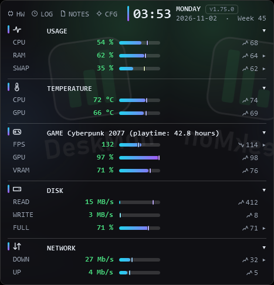
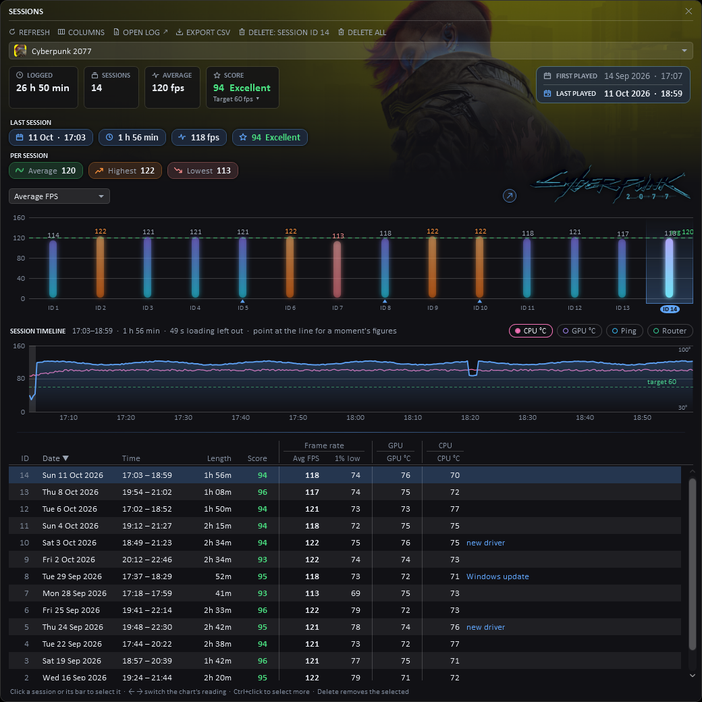
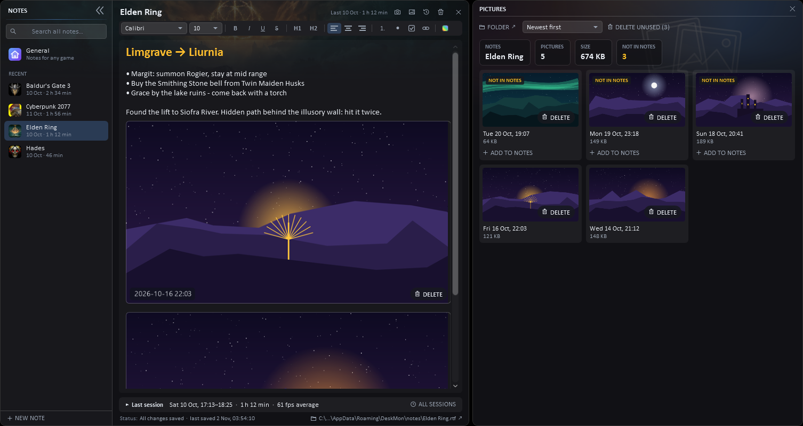
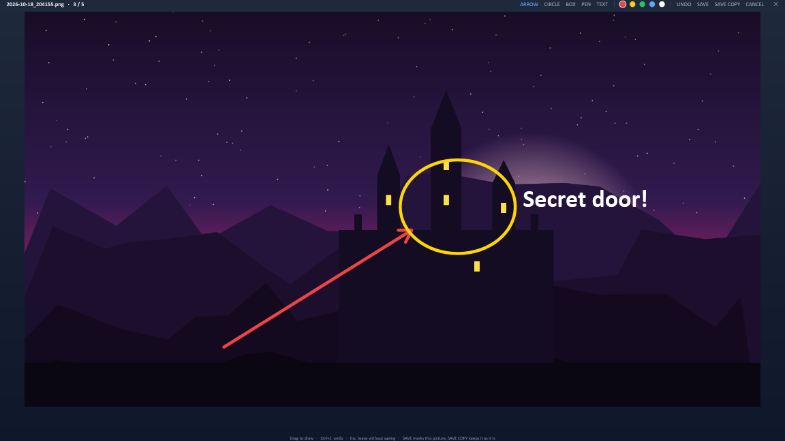
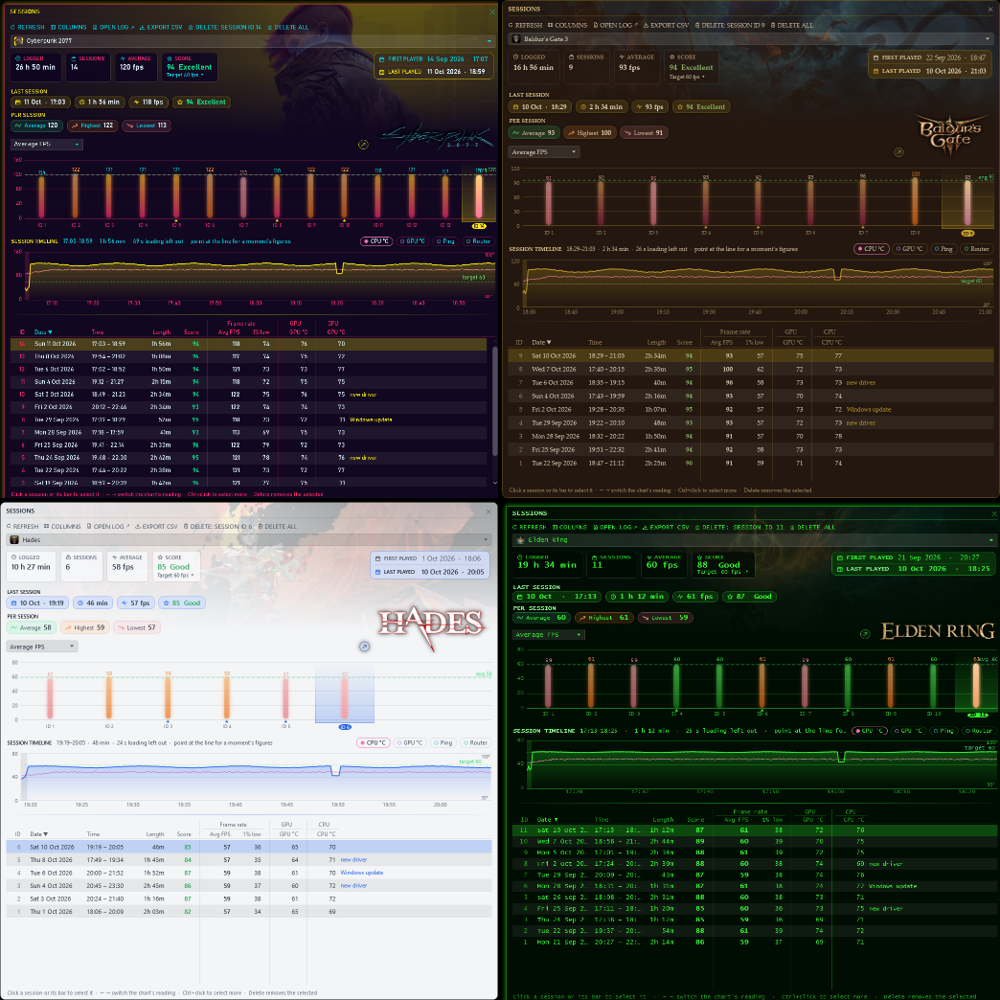
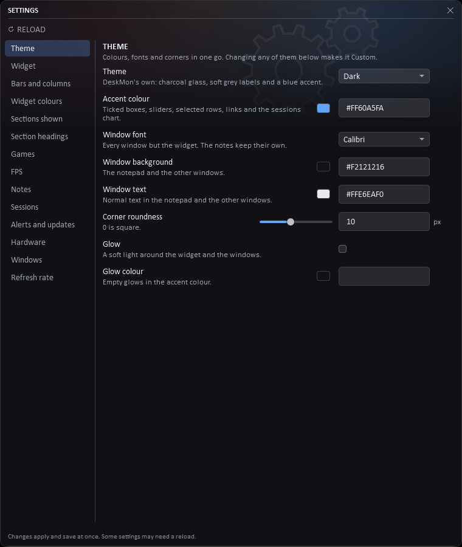

# DeskMon

**A small system monitor for Windows 11 that sits on your desktop and over your games.** It shows how hard your PC is working, measures how well your games run, and keeps your game notes and screenshots in one place.



**[Download the latest release](https://github.com/niclasthornqvist/DeskMon/releases/latest)**

Use DeskMon if you want to:

- keep an eye on temperatures and load without opening Task Manager;
- see your FPS and find out why a game stutters;
- look back at how every play session ran;
- keep notes and screenshots for each game.

DeskMon is one file, `DeskMon.exe`, and there's no installer. Your data stays on your PC.

<br clear="right">

## Features

| Part | What it does |
|---|---|
| **Widget** | Live CPU, RAM, swap, temperatures, disk and network, each with a bar and its peak. Fold what you don't need, and give games their own layout. |
| **While you play** | FPS, 1% lows, GPU load, VRAM and playtime, plus an optional large FPS counter over the game. Ping too, to the nearest server, a region you pick, or a game server's own address. |
| **Sessions** | A log of every session, with a score out of 100, a minute-by-minute timeline, what held the frame rate back, and what else was busy during a dip. |
| **Notes** | Notes for each game, with formatting, checklists, links and in-game screenshots. |
| **Pictures** | Browse your screenshots, star favourites, and mark them up with arrows, circles, boxes, a pen and text. |
| **Hardware** | Everything in your PC at a glance. Tells you when your graphics driver or BIOS is out of date, and checks gaming settings such as Game Mode. |
| **Alerts** | A notification when something stays too hot or too full. |
| **Themes** | 13 built-in looks that change the whole program, or make your own. |

## Get started

**1. Install .NET 10.** DeskMon needs the .NET 10 Desktop Runtime to start. Open PowerShell and run the command below, or start DeskMon and Windows will offer the download.

```powershell
winget install Microsoft.DotNet.DesktopRuntime.10
```

| DeskMon version | .NET you need | Install command |
|---|---|---|
| 1.76.0 and newer | .NET 10 Desktop Runtime | `winget install Microsoft.DotNet.DesktopRuntime.10` |
| 1.75.1 and older | .NET 8 Desktop Runtime | `winget install Microsoft.DotNet.DesktopRuntime.8` |

**2. Download `DeskMon.exe`** from the [latest release](https://github.com/niclasthornqvist/DeskMon/releases/latest) and put it in a folder of its own.

**3. Start it** and choose **Yes** when Windows asks for administrator rights. The widget appears on your desktop, with an icon in the notification area. If you can't see the icon, look under the `^` arrow on the taskbar.

**4. Choose Install when DeskMon offers its tools.** It only asks about what's missing. If you choose **No thanks**, DeskMon still works and you can install them later from the Versions window.

| Tool | Needed for | Without it |
|---|---|---|
| Intel PresentMon | FPS and lows | Those rows show `n/a`. |
| PawnIO | CPU temperature | That row shows `n/a`. |

**5. Start with Windows (optional).** Open `CFG` on the widget, then **Widget**, and tick **Start with Windows**. DeskMon then starts at logon without asking for administrator rights each time.

**6. Play a game.** DeskMon notices it on its own and starts measuring.

## Using DeskMon

| To do this | Do this |
|---|---|
| Open a window | Click `HW` for hardware, `LOG` for sessions, `NOTES` for notes or `CFG` for settings |
| Get all the options | Right-click the widget or the notification area icon |
| Move the widget | Drag it |
| Fold a section | Click its heading |
| Hide or show the widget | Left-click the notification area icon |
| Show or hide the in-game FPS counter | `Ctrl+Shift+F11` |
| Take a screenshot for your notes | `Ctrl+Shift+F12` in a game |

## A closer look

### Sessions

Every session is saved when you quit the game, with its length, frame rate, lows and temperatures. The score out of 100 is based on your target frame rate. Pick a session to see it minute by minute. Loading screens and shader compiling are left out, so the figures describe actual play.



### Notes and pictures

Notes open on their own when a game starts. Press the screenshot key in a game and the picture lands in that game's notes. The pictures window shows which pictures aren't in your notes, so you can add or delete them.



Click a picture to open the viewer. You can zoom, step between pictures and mark them up.



### Themes

Choose from Dark, Light, Cyberpunk, Neon, Fantasy, Futuristic, Retro terminal, Minimalist, Ocean, Sunset, Forest, Dracula or Nord.



### Settings

Everything can be changed in the settings window, and most changes apply at once.



## Good to know

**Why does it need administrator rights?** Reading the CPU temperature and measuring FPS both need low-level access to Windows.

**What does it connect to?** Your notes, sessions and screenshots are never uploaded. DeskMon only goes online to:

- check GitHub for a new DeskMon version once a day;
- check for newer drivers and BIOS versions;
- fetch game art from the Steam store, which sends the game's name;
- ping a server while a game runs. That's Cloudflare's 1.1.1.1 unless you pick another, and you can turn it off in Settings.

**How do I update?** DeskMon tells you when a new version is out but never installs anything by itself. Exit DeskMon, download the new `DeskMon.exe` and replace the old one. If you're updating from 1.75.1 or older, install .NET 10 first, or the new version won't start. If you don't want the check, turn off **Check for updates** in `CFG`, under **Alerts and updates**.

**Where is my data?** In `%APPDATA%\DeskMon`. Game art is cached in `%LOCALAPPDATA%\DeskMon`.

**How do I remove it?** Untick **Start with Windows**, exit DeskMon and delete `DeskMon.exe`. Delete the two folders above as well if you don't want to keep your notes and sessions.

**Does frame generation change the FPS?** With DLSS frame generation at 2x, DeskMon counts rendered frames, so it can show about half of what the game's own counter says.

---

<sub>Screenshots use made-up notes and sessions.</sub>
