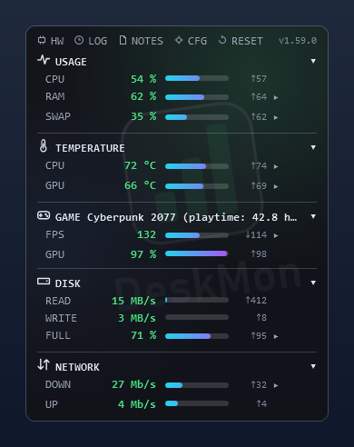
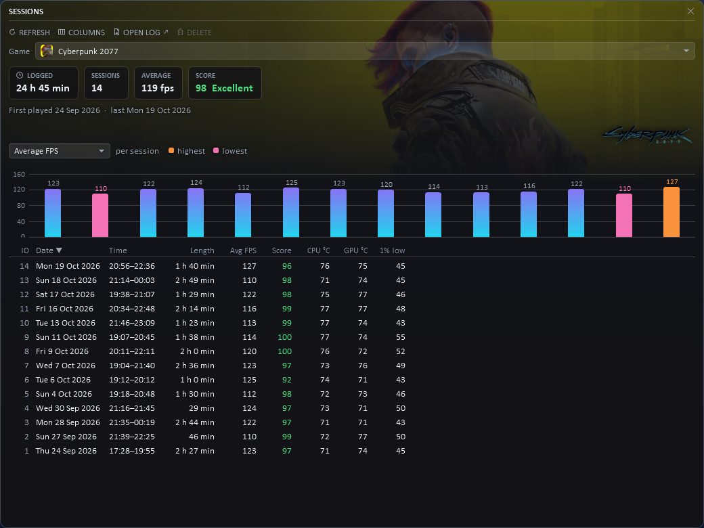
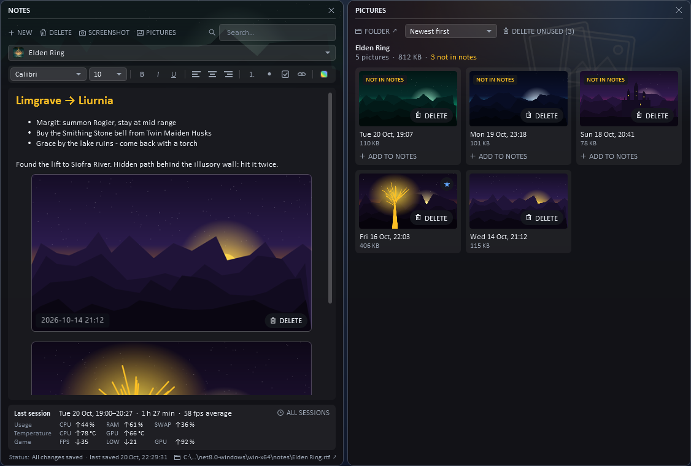
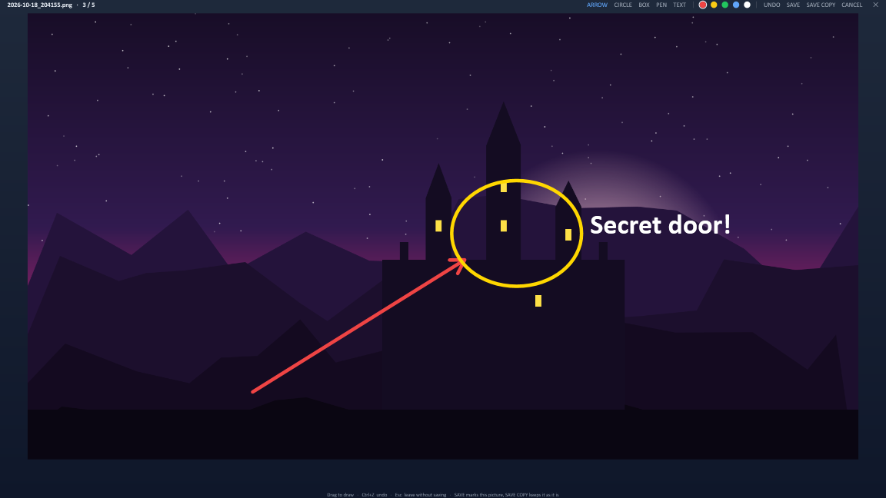
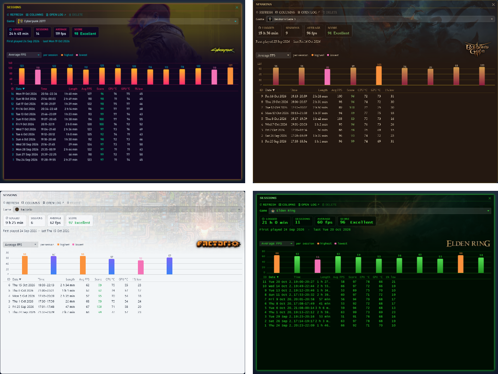
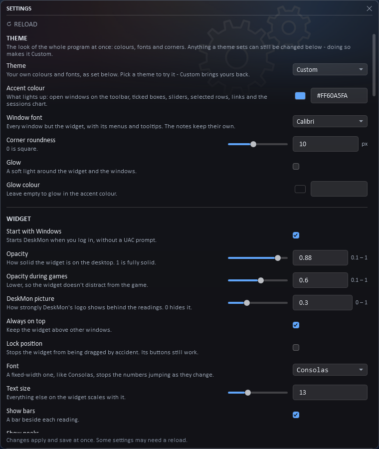

# DeskMon

A small system monitor for Windows that sits on your desktop and over your games. It also keeps game notes with screenshots and a history of every play session.

**The widget**

- CPU, RAM, swap, temperatures, disk and network at a glance, each with a bar and its peak.
- While a game runs: FPS, 1% lows, GPU load and ping, plus the game's playtime.
- Fold the sections you don't need. Games get a layout of their own.
- Alerts when something stays too hot or too full.

**[Download the latest release](https://github.com/niclasthornqvist/DeskMon/releases/latest)**: one file, `DeskMon.exe`. Run it as administrator for CPU temperatures.

 

## Sessions

Every session is logged with its length, frame rate, lows and temperatures. Each session and each game gets a performance score out of 100, based on your target frame rate. The window shows the game's art and logo behind the numbers.

## Notes and pictures

Notes for each game, with formatting, checklists, links and screenshots taken in-game. The pictures window docks beside the notes and lets you:

- star favourites;
- copy a picture;
- see which pictures aren't in the notes;
- delete a picture with the badge in its corner.

Click a picture to open the built-in viewer. It zooms and steps between pictures, and you can mark a picture up with arrows, circles, boxes, a pen and text.

## Themes

One setting changes the look of the whole program. Pick a theme or make your own: Dark, Light, Cyberpunk, Neon, Fantasy, Futuristic, Retro terminal, Minimalist, Ocean, Sunset, Forest, Dracula or Nord.

## Settings

Everything can be changed in the settings window, and changes apply at once.

---

Screenshots use made-up notes and sessions.
